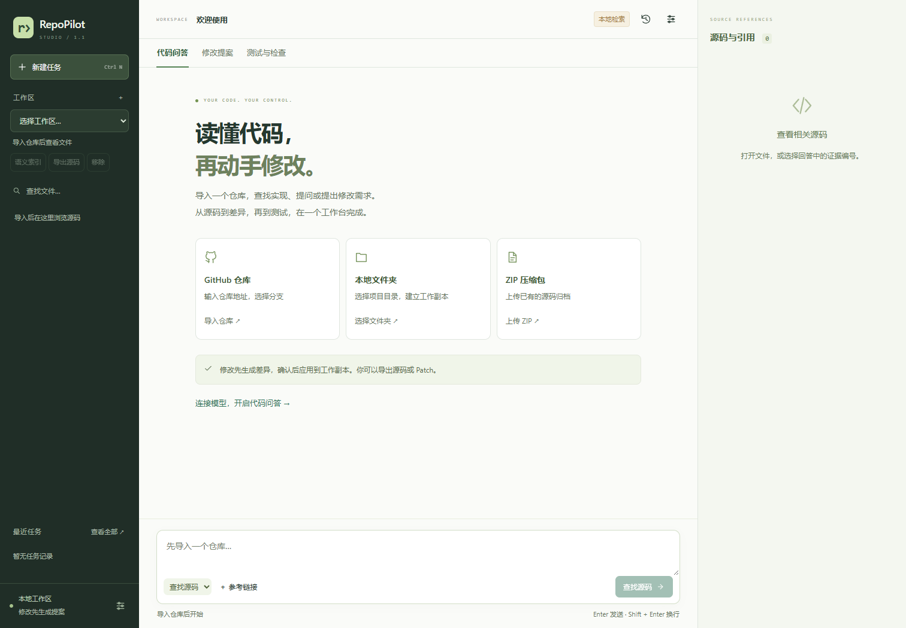

# RepoPilot Studio

A local workspace for reading code, asking questions with source references, and reviewing changes before applying them.

Import a GitHub repository, a local folder, or a ZIP. Browse the source, connect an OpenAI-compatible model, review the proposed diff, and save a new workspace version. Export the result as source files or a Patch, or create a draft GitHub pull request.

[中文使用指南](docs/START_HERE.zh-CN.md) · [Testing](docs/TESTING.md) · [Architecture](docs/ARCHITECTURE.md) · [API](docs/API.md)



## Quick start

Requires Python 3.11+. The frontend is included; no Node.js build is needed.

```bash
python -m venv .venv
# macOS / Linux
source .venv/bin/activate
# Windows PowerShell
# .\.venv\Scripts\Activate.ps1
python -m pip install -e ".[ai]"
python -m uvicorn repopilot.api:app --host 127.0.0.1 --port 8000
```

Open **http://127.0.0.1:8000** and import a repository. In Settings, enter your service address, model name and API Key, test the connection, then save. Enable AI mode and source sharing to use questions, reviews and change proposals.

Installing with `pip install -e .` also supports local keyword search, manual edits, static checks and the direct HTTP model adapter. The `ai` extra adds LangChain and native LangGraph checkpoints. The optional `postgres` extra adds PostgreSQL checkpoint storage.

`start.sh` and `start.bat` reuse an installed `.venv`. Data and settings are stored in `.repopilot/`, or in the directory selected by `STUDIO_DATA_DIR`.

## What you can do

- **Read and search:** multiple workspaces, file filtering, line-numbered source, Python symbols and optional Embedding-based semantic retrieval.
- **Ask and review:** streamed answers with source references, bounded read tools, optional independent analysis and review, task history, cancellation and recovery.
- **Propose and apply:** manual or AI-generated file changes, exact diff previews, version conflict checks, approval, undo proposals and git-applicable patches.
- **Check a version:** Python / JSON / TOML syntax checks; optional Docker profiles for pytest, unittest and Node.js `--test`, with live output and cancellation.
- **Share a result:** export source or reports; preview and confirm a branch and draft PR for a GitHub workspace.
- **Work on mobile:** open the file drawer, switch workspaces and inspect answer references.

## The workflow

```text
Import → inspect / ask → review a diff → apply to a new version
                                           ↓
                                      check / test
                                           ↓
                              export or create a draft PR
```

Imported files are a filtered UTF-8 source snapshot. Changes apply to that workspace copy. Export them or use a draft PR to carry the changes back to your project.

Local retrieval and manual editing work without a model. AI and Embedding features send selected source content to your configured service after you enable sharing. Credentials are stored in a local plaintext settings file and are never returned to the frontend or stored in browser storage.

Code execution requires Docker and a prepared test image. Syntax checks only parse files. The app is intended for one operator on localhost; see [Security](SECURITY.md) for the source, model, container and publishing boundaries.

## Development and verification

```bash
python -m pip install -e ".[ai,dev,ui-test]"
python -m pytest -q
# Uses an installed Chromium browser, or install Playwright Chromium:
python -m playwright install chromium
python scripts/check_ui.py
python scripts/verify_release.py
```

The browser checks use a temporary data directory and a real local HTTP server. The validation scope and optional integrations are recorded in [docs/VALIDATION.md](docs/VALIDATION.md).

After reviewing source changes, rebuild the manifest and create a clean source archive:

```bash
python scripts/verify_release.py --update --archive ../repopilot-studio-source.zip
```

The archive excludes local settings, databases, virtual environments, caches and installation metadata. The script checks source hashes and common credential patterns. Keep credentials out of source files even when they are already ignored by Git.

```text
repopilot/  Backend and frontend source
sandbox/    Docker test runner and image recipes
scripts/    Diagnostics, browser checks, evaluations and release packaging
tests/      Regression and integration tests
docs/       Setup, architecture, API and validation
.github/    CI workflows
```

MIT license. See [CONTRIBUTING.md](CONTRIBUTING.md) to contribute.
